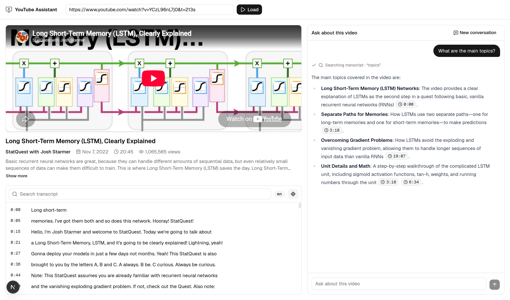
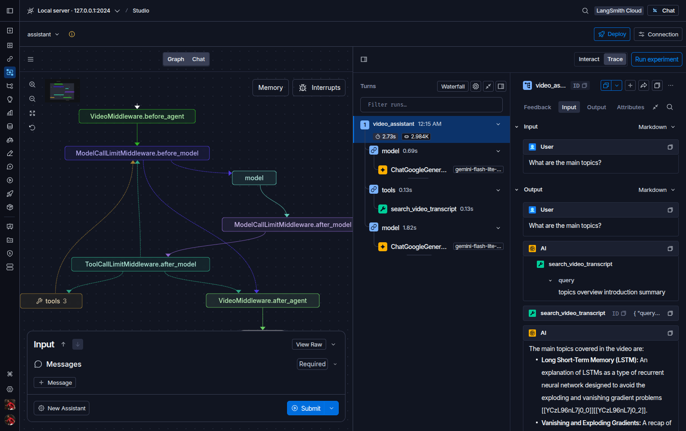

# YouTube Assistant

[](https://www.python.org)
[](https://docs.astral.sh/uv/)
[](https://langchain-ai.github.io/langgraph/)
[](https://python.langchain.com)
[](https://ai.google.dev/gemini-api/docs)
[](https://modelcontextprotocol.io)
[](https://github.com/langchain-ai/langchain-mcp-adapters)
[](https://fastapi.tiangolo.com)
[](https://docs.pydantic.dev)
[](https://qdrant.tech)
[](https://huggingface.co/sentence-transformers/all-MiniLM-L6-v2)
[](https://developers.google.com/youtube)
[](https://smith.langchain.com)
[](https://nodejs.org)
[](https://nextjs.org)
[](https://react.dev)
[](https://www.typescriptlang.org)
[](https://tailwindcss.com)
[](https://ui.shadcn.com)
[](https://github.com/langchain-ai/langgraphjs)
[](https://tanstack.com/query)
[](https://zod.dev)
[](https://docs.pytest.org)
[](https://docs.astral.sh/ruff/)
[](https://vitest.dev)
[](https://eslint.org)

Watch a YouTube video, search its transcript, and ask questions. Answers come from the transcript and cite the moments they are based on; clicking a citation seeks the player.

- **Backend:** one LangGraph Agent Server (`langgraph dev`) that provides threads, runs, streaming and checkpoints. It also serves the custom `/api/*` video routes and a mounted MCP server.
- **Agent:** LangChain `create_agent` with Gemini (`ChatGoogleGenerativeAI`). Its tools come from the MCP server through `langchain-mcp-adapters`.
- **RAG:** `HuggingFaceEmbeddings` (all-MiniLM-L6-v2), `QdrantVectorStore` in local persistent mode, and the stock LangChain retriever filtered by video ID.
- **Frontend:** Next.js (App Router), Tailwind, shadcn/ui, `@langchain/langgraph-sdk` (`useStream`), YouTube IFrame API.

## Screenshots

**The app:** player and video details, searchable transcript, and a streamed answer whose timestamp chips seek the player.



**LangGraph Studio:** the `assistant` graph with its middleware nodes and the trace of one run, including the `search_video_transcript` MCP tool call and both Gemini calls.



## Requirements

Python 3.12+, [uv](https://docs.astral.sh/uv/), Node 20.9+, a [Gemini API key](https://aistudio.google.com/apikey) and a YouTube Data API v3 key. Without the YouTube key, transcripts and chat still work, but video details are replaced by a notice.

## Setup

```bash
# Backend
cd backend
cp .env.example .env        # fill in GOOGLE_API_KEY and YOUTUBE_API_KEY
uv sync
uv run langgraph dev        # http://localhost:2024 (Studio link is printed)

# Frontend (second terminal)
cd frontend
cp .env.example .env.local
npm install
npm run dev                 # http://localhost:3000 (3001 if 3000 is busy)
```

The first video load downloads the embedding model (~90 MB). CORS allows `localhost`/`127.0.0.1` on ports 3000 and 3001 (`backend/langgraph.json`). Change it there if you use another port.

## How it works

1. **Load a video.** `POST /api/videos` runs the `ingestion` graph: validate URL, fetch metadata (best effort), skip if already indexed, fetch and cache captions (`backend/data/transcripts`), chunk with timestamps, embed, upsert into Qdrant (`backend/data/qdrant`). Point IDs are deterministic, and an on-disk marker is written only after a complete index, so re-runs and partial failures are safe. A video without captions returns `status: "failed"` with the reason and its metadata, so the player still works.
2. **Chat.** The frontend calls the Agent Server directly through the SDK. Each video gets one thread (ID kept in `localStorage`). Every run sends `context: {video_id}`; the backend pins the thread to that video and rejects a different one.
3. **Video isolation.** The MCP tools take a `video_id`, but the agent never supplies it. A `langchain-mcp-adapters` interceptor overwrites it from the run context, and the argument is removed from the schema the model sees. The retriever filter is applied in Qdrant.
4. **Citations.** The model cites `[[chunk_id]]`. An `after_agent` middleware checks each ID against chunks actually returned by `search_video_transcript` in that thread and attaches `{chunk_id, start_time, end_time, text}` from the retrieval result to the message. Unknown IDs are removed. Timestamps never come from the model.
5. **Skills.** `backend/app/skills/*.md` are loaded once; grounding is always included, summarization is added for summary-style questions (`agents/prompts.py`).
6. **Limits.** Per run: 6 tool calls and 8 model calls (`MAX_TOOL_CALLS`, `MAX_MODEL_CALLS`).
7. **Tracing (optional).** With `LANGSMITH_TRACING=true` and a `LANGSMITH_API_KEY`, every agent and ingestion run is traced to the `LANGSMITH_PROJECT` project in LangSmith. Without a key, nothing is sent.

### MCP server

`backend/app/mcp/youtube_server.py` (FastMCP) exposes `get_video_info`, `get_video_transcript` and `search_video_transcript`. It is mounted at `/api/mcp/` inside the Agent Server (streamable HTTP, localhost only), so it shares the process and the Qdrant lock. The agent reaches it at `LANGGRAPH_API_URL`; set that variable if you change the port. External MCP clients must pass `video_id` themselves.

## Configuration

| Variable | Default | Notes |
|---|---|---|
| `GOOGLE_API_KEY` | | Required. Backend only, never exposed to the browser |
| `YOUTUBE_API_KEY` | | Optional. Without it, video details show a notice |
| `LANGSMITH_TRACING`, `LANGSMITH_API_KEY`, `LANGSMITH_PROJECT` | `false`, empty, `youtube-assistant` | Optional tracing. Set a key and `LANGSMITH_TRACING=true` to trace runs |
| `HF_TOKEN` | | Optional. Avoids Hugging Face rate limits when downloading the embedding model |
| `GEMINI_MODEL` | `gemini-flash-lite-latest` | Alias avoids pinning a retired model; set an exact model if you prefer |
| `EMBEDDING_MODEL` | `sentence-transformers/all-MiniLM-L6-v2` | Changing it re-indexes videos on next load |
| `QDRANT_PATH`, `QDRANT_COLLECTION` | `./data/qdrant`, `video_transcripts` | Path is relative to `backend/` |
| `TRANSCRIPT_CACHE_DIR` | `./data/transcripts` | Cached captions and index markers |
| `TOP_K` | `5` | Chunks per search |
| `CHUNK_TOKENS`, `CHUNK_OVERLAP_TOKENS` | `240`, `40` | See limitations |
| `MAX_TOOL_CALLS`, `MAX_MODEL_CALLS` | `6`, `8` | Per-run agent limits |
| `HTTP_TIMEOUT_SECONDS` | `10` | YouTube Data API timeout |
| `LANGGRAPH_API_URL` | `http://localhost:2024` | Frontend uses `NEXT_PUBLIC_LANGGRAPH_API_URL` |

## Checks

```bash
cd backend && uv run ruff check . && uv run pytest
RUN_INTEGRATION=1 uv run pytest tests/integration   # needs `langgraph dev` running and network

cd frontend && npm run lint && npm run typecheck && npm test && npm run build
```

## Limitations

- **Chunk size.** The embedding model truncates input at 256 word pieces, so chunks default to about 240 tokens instead of the suggested 500–800. Larger chunks would be partly invisible to search. Citations point to the start of a chunk (tens of seconds), not to the exact sentence.
- Videos without captions cannot be indexed (no speech-to-text fallback).
- Citation chips appear when the answer completes; markers are hidden while streaming.
- No authentication. Keep the server bound to localhost.
- Qdrant local mode allows one process at a time. Do not run a second backend on the same `QDRANT_PATH`.
